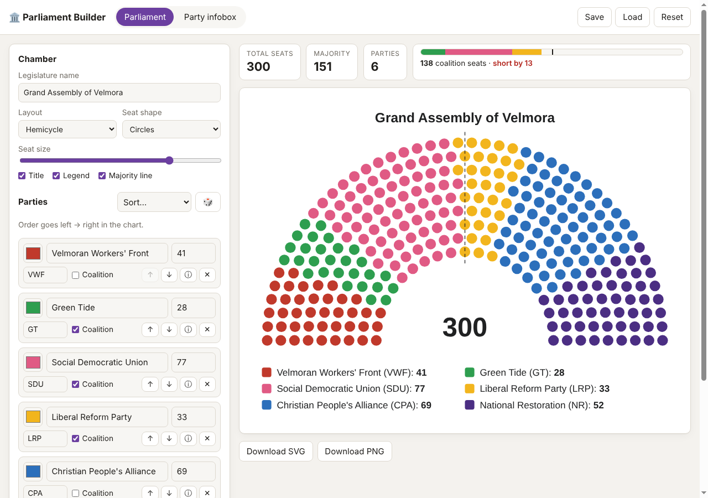

# 🏛️ Parliament Builder

Build fictional parliaments, make Wikipedia-style infoboxes for their parties, then try governing one. Runs entirely in the browser with no build step and no backend.



## Features

**Parliament**
- Unicameral or bicameral: each chamber has its own name, layout and seat counts, while parties are shared between them
- Hemicycle, horseshoe, circle and Westminster layouts
- Each party gets a clean wedge of seats, and you can reorder parties left to right
- Coalition tracker: tick parties to see whether they reach a majority
- Optional majority line, title and legend; circle or square seats; adjustable seat size
- Westminster benches: government, opposition, crossbench and speaker (or "auto", based on coalition)
- 🎲 Random parliament generator for when you need inspiration
- Export as **SVG** or **PNG**

**Party infobox**
- Styled after Wikipedia's `{{Infobox political party}}`
- Logo upload, multiple leaders, ideology list, colours swatch, custom rows
- Seat bars pull straight from the parliament (one per chamber), and you can add extra rows (regional councils and so on)
- Export as **PNG**, or copy the **wikitext** to paste into a wiki

**Government sim**
- Govern the parliament you built, one quarter at a time, starting in 2029
- Whoever's ticked as **Coalition** governs, based on the lower house; a cabinet is handed out between them (names are editable)
- Each quarter, pick one of three bills and put it to a vote. Parties take a whip line based on how far the bill is from their **Political position** (from the infobox), members sometimes rebel, independents vote one by one, and the result is drawn as a division chart. In a bicameral legislature a bill has to pass both houses
- Random events, some with choices (sack the minister or stand by them?)
- An economy (growth, unemployment and the budget balance): bills show their economic effects, events can knock it about, and voters notice
- Approval rating, polls with a seat projection, and an approval trend line
- By-elections fill vacant seats, and members can quit or get expelled mid-term, so thin majorities can slip away
- 17 achievements, kept in your browser across resets and new runs
- Seeded runs: the same seed, starting parliament and choices replay the same story, so you can share a seed or retry a run
- Elections every 4 years (first-past-the-post or proportional) rewrite the seat counts of every chamber in the Parliament tab, and the winners form a government. Minority governments can face no-confidence votes in the lower house
- Elections can be undone, in case you really don't like the result

**Data**
- Autosaves in your browser (localStorage)
- **Save** and **Load** a `.json` file to back up or share a whole universe

## Running it

Open `index.html` in a browser. That's it.

To host it on GitHub Pages, go to **Settings → Pages**, choose **Deploy from a branch**, then pick `main` and `/ (root)`.

## Project layout

```
index.html          page shell
css/style.css       app UI (light + dark)
css/wikibox.css     the Wikipedia-style infobox
js/state.js         state, storage, helpers, random generator
js/parliament.js    seat layout algorithms + SVG rendering
js/infobox.js       infobox HTML + wikitext export
js/government.js    government sim: votes, events, polls, elections
js/app.js           UI wiring
```

The only external dependency is [html-to-image](https://github.com/bubkoo/html-to-image), loaded from a CDN for the infobox PNG export. Everything else works offline.

## License

MIT
